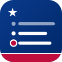
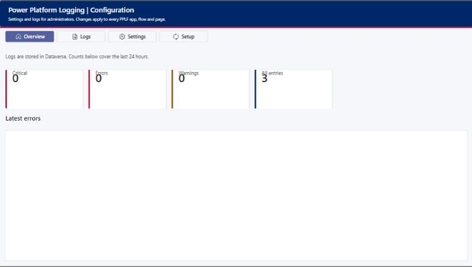
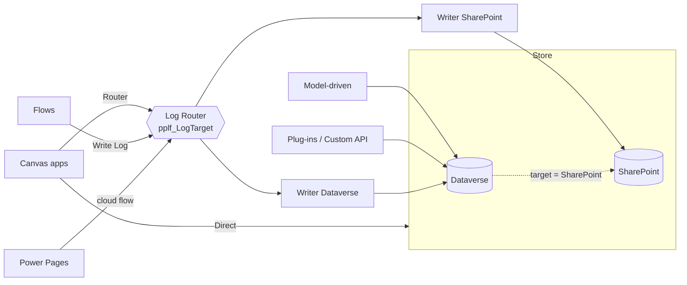

<div align="center">

<p align="center"></p>

# Power Platform Logging Framework

**One logging framework for Power Apps, Power Automate, Power Pages, model-driven apps and Dataverse plug-ins.<br/>Store logs in Dataverse or SharePoint, and switch with one setting.**

[](https://github.com/manjugundala/PPLF/actions/workflows/ci.yml)
[](https://github.com/manjugundala/PPLF/releases)
[](LICENSE)
[](https://manjugundala.github.io/PPLF/)

[Prerequisites](docs/prerequisites.md) · [Get started](docs/getting-started.md) · [Architecture](docs/architecture.md) · [Canvas apps](docs/canvas-apps.md) · [Flows](docs/power-automate.md) · [Power Pages](docs/power-pages.md) · [Contribute](CONTRIBUTING.md)

</div>

---

## Why

Low-code solutions fail quietly. A Patch fails on one user's phone, a flow times out at 2 a.m., a portal form throws a script error, and nobody finds out until a user complains. The run history and monitor tools show one product at a time, they don't keep data for long, and you can't follow one user action from the app to the flow to the plug-in.

PPLF gives every Power Platform component **the same log entry**, **the same levels**, and **one place to read them**, with a **correlation id** that ties a user action together across products.

## Features

- **Every product**: canvas apps (Power Fx), model-driven apps (JavaScript), Power Automate (child flow and Try/Catch template), Power Pages (JavaScript), plug-ins and a Custom API (C#).
- **Dataverse, SharePoint or both**, chosen by one environment variable. The same columns in both stores, so reports and formulas keep working when you switch.
- **A standard-licence path**: SharePoint target, Direct-mode canvas logging and the SharePoint writer use no premium connectors.
- **Configuration as data**: minimum level, on/off and retention per app or flow, with a `*` default row. No redeploy to turn on Debug for one app.
- **Correlation ids** across app → flow → plug-in, run links, durations, error codes and automatic capture of unhandled errors (`App.OnError`, `window.onerror`).
- **Alerts** by email for entries at or above a level, and **retention** cleanup every day.
- **PPLF - Configuration App**: a modern Fluent canvas app to choose the target, create SharePoint lists, manage settings and read logs.
- **Built for Git**: schema-as-code, generated flows, unit tests, CI, an export-to-pull-request workflow and tagged releases with managed and unmanaged solutions.

## Configuration App



The **PPLF - Configuration App** (canvas, modern controls) chooses the log target, creates the SharePoint lists,
sets levels, retention and alerts, and browses logs by level, source and correlation id. 

## How it works



Details, sequence diagrams and the data model: **[docs/architecture.md](docs/architecture.md)**.

## Prerequisites

- A Power Platform environment **with Dataverse**, and **System Administrator** or **System Customizer** in it
- Connections for **Dataverse**, plus **SharePoint** (SharePoint target) and **Office 365 Outlook** (alerts), in the same DLP group
- For the SharePoint target: a site where you can create lists
- Licences that match your target: see [Licensing](docs/licensing.md)

Full list, including tools for contributors: **[Prerequisites](docs/prerequisites.md)**.

## Quick start

1. **Install**: import the managed solution from [Releases](https://github.com/manjugundala/PPLF/releases), or build it from source in your browser:
   open your environment, paste [`dist/pplf-deployer.browser.js`](dist/pplf-deployer.browser.js) into the dev tools console, run `await PplfDeployer.deploy()`.
2. **Connect**: set the three connection references and turn on the flows.
3. **Choose a target**: PPLF - Configuration App → Setup → Dataverse, SharePoint or Both.
4. **Log**: paste a snippet into your app's `App.Formulas`, and call it.

```powerfx
PplfInfo("scrHome", "Opened home screen");

IfError(
    Patch(Expenses, Defaults(Expenses), frmExpense.Updates),
    PplfError("scrSubmit", "SubmitExpense", FirstError.Message, JSON({ status: FirstError.Details.HttpStatusCode }))
)
```

Full walkthrough: **[Getting started](docs/getting-started.md)**.

## Documentation

| Start here | Use PPLF | Run it | Build on it |
|---|---|---|---|
| [Prerequisites](docs/prerequisites.md) | [Canvas apps](docs/canvas-apps.md) | [Configuration App](docs/configuration-app.md) | [Architecture](docs/architecture.md) |
| [Getting started](docs/getting-started.md) | [Power Automate](docs/power-automate.md) | [Configuration](docs/configuration.md) | [ALM and Git](docs/alm-and-git.md) |
| [How PPLF compares](docs/comparison.md) | [Power Pages](docs/power-pages.md) | [Retention and alerts](docs/retention-and-alerts.md) | [Schema reference](docs/reference/schema.md) |
| [FAQ](docs/faq.md) | [Model-driven apps](docs/model-driven-apps.md) | [Security and privacy](docs/security.md) | [Decisions (ADRs)](docs/adr/README.md) |
| | [Plug-ins and Custom API](docs/plugins.md) | [Licensing](docs/licensing.md) · [Troubleshooting](docs/troubleshooting.md) | [Contributing](CONTRIBUTING.md) |

## What a log entry looks like

| Field | Example |
|---|---|
| Level / Severity | Error / 4 |
| Source Type / Source Name | Canvas App / Contoso Expenses |
| Component / Operation | scrSubmit / SubmitExpense |
| Message | Patch to Expenses failed: network error |
| Details (JSON) | `{"expenseId":"E-1042","amount":125.4}` |
| Correlation Id / Session Id | `6f1c2a9e-…` / `b2d0c6c4-…` |
| User, App Version, Environment, Client Info | megan@contoso.com, 1.4.0, Contoso-Prod, Web; Edge |
| Run Url, Duration (ms), Error Code, Client Timestamp | link to the flow run, 840, 502, 2026-11-23T18:49:00Z |

Schema: [docs/reference/schema.md](docs/reference/schema.md) · Wire format: [schema/log-entry.schema.json](schema/log-entry.schema.json)

## Repository

| Path | Contents |
|---|---|
| [`schema/`](schema) | The single source of truth for tables, lists, choices, environment variables and roles |
| [`src/flows/`](src/flows) | Ten cloud flows (generated from the schema) |
| [`src/canvas/`](src/canvas) | PPLF - Configuration App source and the Power Fx loggers |
| [`src/pages/`](src/pages), [`src/webresources/`](src/webresources), [`src/plugins/`](src/plugins) | Power Pages, model-driven and plug-in loggers |
| [`src/solution/`](src/solution) | The exported, unpacked solution |
| [`tools/`](tools) | Generators, deployer and SharePoint provisioning |
| [`docs/`](docs) | Documentation, ADRs and diagrams |
| [`brand/`](brand) | App icon and theme colours (shared with PPMF) |
| [`.github/`](.github) | CI, release, export and unpack workflows; issue and pull request templates |
| [`samples/`](samples) | A sample canvas screen and a Power Pages snippet |

## Development

```bash
npm run build      # regenerate flows, SharePoint definitions, browser deployer and schema docs
npm test           # unit tests (schema integrity, flow wiring, deployer)
npm run check      # fail if generated files are stale (CI runs this)
npm run lint:yaml  # canvas source lint
npm run deploy:dry # print every request the deployer would make
```

No dependencies to install: Node 22+ and Python 3 with PyYAML are all you need. See [ALM and Git](docs/alm-and-git.md) for the export and release process.

## Roadmap

- Application Insights as a third target
- Power BI template for the log tables
- Elastic-table option for very high volume ([ADR 0005](docs/adr/0005-standard-tables-not-elastic.md))
- Teams alerts and adaptive cards
- Copilot Studio agent logging

Ideas and votes welcome in [Discussions](https://github.com/manjugundala/PPLF/discussions).

## Contributing and support

Contributions are welcome: bug reports, docs, new targets or clients. Read [CONTRIBUTING.md](CONTRIBUTING.md) and the [code of conduct](CODE_OF_CONDUCT.md).
Questions: [SUPPORT.md](SUPPORT.md). Security issues: [SECURITY.md](SECURITY.md). How decisions and releases are made: [GOVERNANCE.md](GOVERNANCE.md).

## Citing

If PPLF helps your work or research, please cite it. GitHub shows a **Cite this repository** button from [`CITATION.cff`](CITATION.cff).

## License

[MIT](LICENSE). Power Platform, Power Apps, Power Automate, Power Pages, Dataverse and SharePoint are trademarks of Microsoft. This project is community-built and not affiliated with or endorsed by Microsoft.
