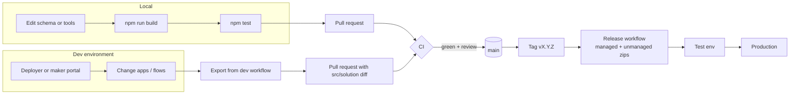

# ALM and Git

Everything in PPLF is text in this repository. Releases are built from source by GitHub Actions; nobody uploads a zip by hand.

## Repository layout

```text
schema/                    single source of truth
  pplf.schema.json         tables, columns, SP fields, choices, env vars, roles, Custom API
  log-entry.schema.json    the wire format every client sends
src/
  flows/                   GENERATED cloud flow definitions (from tools/build/flows.mjs)
  sharepoint/lists.json    GENERATED SharePoint list and field definitions
  canvas/
    configuration-app/Src/         PPLF - Configuration App source (*.pa.yaml)
    snippets/              Power Fx loggers to paste into App.Formulas / App.OnError
  pages/                   Power Pages logger
  webresources/pplf_/      model-driven web resource
  plugins/Pplf.Plugins/    C# logger, base class, Custom API
  solution/                exported, unpacked solution (written by the export workflow)
tools/
  build/                   generators and linters
  deployer/                Dataverse deployer (Node CLI + library)
  sharepoint/              SharePoint provisioning (Node CLI + library)
dist/                      GENERATED browser bundle of the deployer
docs/                      this documentation (published with MkDocs)
samples/                   sample canvas screen and Power Pages snippet
tests/                     node:test unit tests
.github/workflows/         ci, export-from-dev, release, docs
```

## How a change flows



### Two kinds of change

| Change | Where you make it | How it reaches git |
|---|---|---|
| Schema, flow logic, deployer, docs, client loggers | In the repo | Normal commit; `npm run build` regenerates flows and docs |
| Canvas app UI, solution-level tweaks | In the dev environment (Studio, maker portal) | **Export solution from dev** workflow opens a PR |

For flows, change `tools/build/flows.mjs` (not the generated JSON), run `npm run build`, then redeploy to dev with the deployer. Export the solution afterwards so `src/solution` matches.

## Setting up the export workflow

1. Create an Entra ID app registration with a client secret.
2. In the dev environment: **Power Platform admin center → Environments → dev → Settings → Users + permissions → Application users → New**, choose the app, give it **System Administrator**.
3. Repository **Settings → Secrets and variables → Actions**: add `PPLF_DEV_URL`, `PPLF_APP_ID`, `PPLF_CLIENT_SECRET`, `PPLF_TENANT_ID`.
4. **Actions → Export solution from dev → Run workflow**.

## Native Git integration (alternative)

Power Platform's built-in [Git integration](https://learn.microsoft.com/power-platform/alm/git-integration/overview) can commit the solution from the maker portal instead of the export workflow. If you use it, point it at a separate branch and folder (for example `src/solution`), and keep the release workflow as the only way to build zips.

## Versioning

- Semantic versions: **major** for breaking schema changes (renamed or removed columns, changed choice values), **minor** for new columns, flows or features, **patch** for fixes.
- The solution version is the same with a fourth part: `1.4.2` → `1.4.2.0`. The export workflow can stamp it.
- `schema.version` in `pplf.schema.json` follows the release.

## Upgrading an environment

Import the newer **managed** solution as an **upgrade**. Your environment variable values, configuration rows and logs are data, so they are kept. Customizations you made in your own solution layer on top and are not overwritten.
