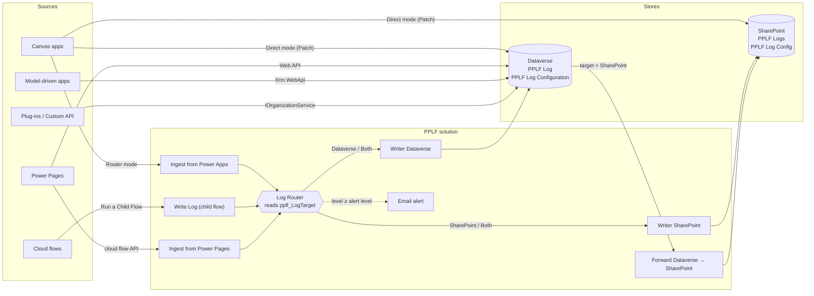
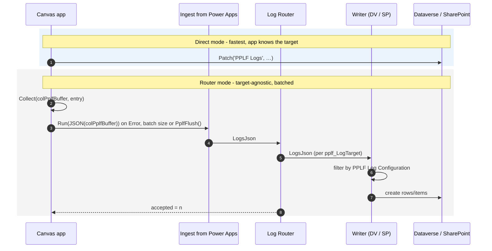
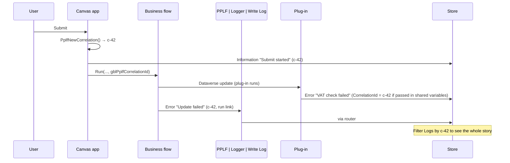
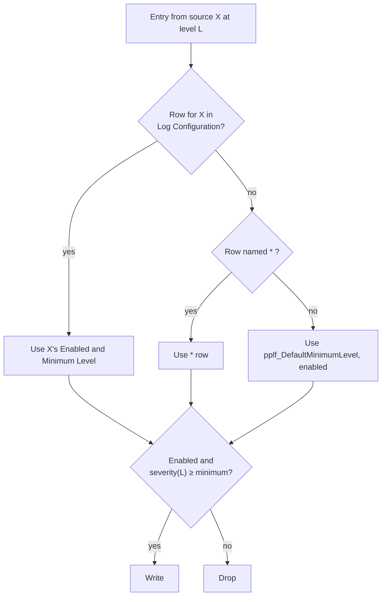
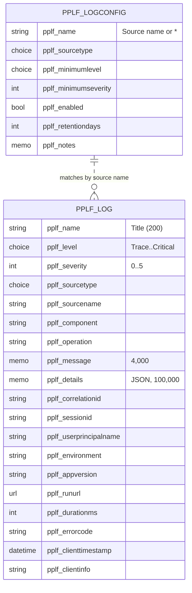

# Architecture

PPLF has one idea at its centre: **every Power Platform component writes the same log entry shape, and one setting decides where it is stored.**

## Overview

## Components

| Component | What it is | Where |
|---|---|---|
| **Schema** | Tables, columns, SharePoint fields, choices, environment variables, connection references and roles in one JSON file | `schema/pplf.schema.json` |
| **Wire format** | The JSON shape of a log entry that every client sends | `schema/log-entry.schema.json` |
| **Tables** | `pplf_log` (entries) and `pplf_logconfig` (per-source settings), organization-owned | Dataverse |
| **Lists** | `PPLF Logs` and `PPLF Log Config`, same columns, indexed | SharePoint |
| **Router** | Child flow that reads `pplf_LogTarget` and calls the writer(s); sends alerts | `src/flows/log-router.json` |
| **Writers** | One per store. Apply the per-source minimum level, then write | `src/flows/writer-*.json` |
| **Entry points** | Flows that Power Apps, Power Pages and other flows call | `src/flows/ingest-*.json`, `write-log.json` |
| **Client loggers** | Power Fx functions, Power Pages script, model-driven web resource, C# logger | `src/canvas`, `src/pages`, `src/webresources`, `src/plugins` |
| **Admin app** | Canvas app to set the target, provision SharePoint, manage settings and read logs | `src/canvas/admin-app` |
| **Deployer** | Builds everything above in an environment from the schema | `tools/deployer`, `dist/pplf-deployer.browser.js` |

## Two ways for canvas apps to log

Canvas apps can either write straight to the store or send entries through the router. Both use the same function names (`PplfInfo`, `PplfError`, …), so switching is a paste.

| | Direct mode | Router mode |
|---|---|---|
| Latency | One `Patch` | One flow call per batch |
| Flow runs used | None | One per batch (plus child flows) |
| Changing the target | Swap the snippet and data source | Change one environment variable |
| Licence for SharePoint target | Standard | Standard (see [licensing](licensing.md)) |
| Works offline | Failures kept in `colPplfFailed` | Buffer kept until the next successful flush |

Choose **Direct** for busy apps, and **Router** for apps whose target must change without republishing. The reasons are recorded in [ADR 0003](adr/0003-canvas-direct-and-router-modes.md).

## A request end to end, with correlation

A correlation id ties together everything one user action causes, across products.

## Configuration resolution

Every writer decides whether to keep an entry like this:

Canvas Direct mode and the model-driven logger apply the same rule on the client, so dropped entries never leave the device.

## Data model

The match is by name rather than a lookup column on purpose: SharePoint has no cheap equivalent, a missing config row must never block logging, and log rows must stay cheap to write. See [ADR 0002](adr/0002-same-schema-in-both-stores.md).

Full column list: [schema reference](reference/schema.md).

## Design principles

1. **Logging never breaks the caller.** Every client catches its own failures; flows return success to the app even when an alert email fails.
2. **One schema, generated everything.** The flows, SharePoint fields, docs and deployer all come from `schema/pplf.schema.json`, and CI fails if they drift.
3. **Standard-licence path exists.** SharePoint logging works without premium connectors.
4. **Configuration is data.** Levels, retention and alerting change without republishing anything.
5. **Source control first.** Every component is text, reviewed in pull requests, and released as managed and unmanaged solutions.
