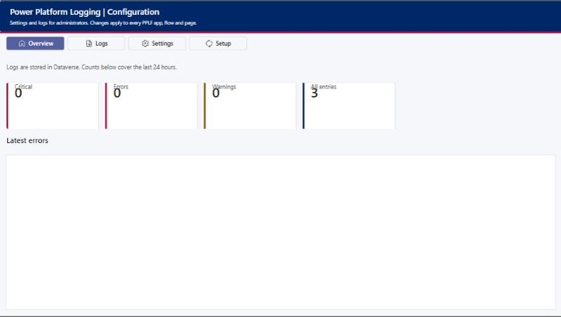

# PPLF - Configuration App

The **PPLF - Configuration App** is a canvas app for administrators. It ships in the PPLF solution and is the
only place you need to change how logging behaves in an environment.

## Who uses it

Administrators with the **PPLF | Log Administrator** role. Users who only write logs never open it.

## Screens

| Screen | What you do there |
|---|---|
| **Overview** | Counts of Critical, Error and Warning entries and all entries in the last 24 hours, and the latest errors. Select a count to open the Logs screen filtered to that level. |
| **Logs** | Filter by minimum level, source name, correlation id, title and date. Select an entry to see every field, its details JSON and a link to the flow run. **Show everything with this correlation id** follows one user action across app, flow and plug-in. |
| **Settings** | Environment-wide defaults (minimum level, retention days, alert level, alert recipients), stored as environment variable values. Per-source rows in **PPLF \| Configuration**: minimum level, on/off and retention for each app or flow, with a `*` row for everything else. |
| **Setup** | 1. Choose the log target: Dataverse, SharePoint or Both. 2. Create the SharePoint lists on a site. 3. Send a test entry through the router and find it in Logs. |

The app logs its own actions (target changes, settings saved, provisioning) to PPLF with the source name
`PPLF - Configuration App`, so every configuration change is audited.

## How it is built

| Topic | Approach |
|---|---|
| Controls | Modern (Fluent) controls in auto-layout containers, so the layout adapts to the screen size |
| Theme | The `BrandTheme` record from the [Power Platform Monitoring Framework](https://github.com/manjugundala/PPMF), set in `App.OnStart`: navy `#002868`, red `#BF0D3E`, background `#F5F7FA`. See [brand/README.md](https://github.com/manjugundala/PPLF/blob/main/brand/README.md). |
| Logic | Named formulas and user-defined functions in `App.Formulas`: `PplfEnv` and `PplfSetEnv` read and write environment variables, `PplfAdminLog` writes the app's own audit entries |
| Data | `PPLF | Logs`, `PPLF | Configurations`, `Environment Variable Definitions`, `Environment Variable Values`, and two flows: `PPLF | Ingest | Power Apps` (test entry) and `PPLF | Setup | Provision SharePoint` |
| Errors | `App.OnError` writes unhandled errors to PPLF before they are shown |

## Source and how to change it

The app's source lives in two forms:

- **`src/solution/`**: the exported, unpacked solution, including the canvas app sources. This is what releases are built from.
- **`src/canvas/configuration-app/Src/`**: hand-written `.pa.yaml` screens and `App.pa.yaml`. They are the readable source of truth for review, and the `paste/` folder next to it is generated from them.

To change the app:

1. Edit the screen in `src/canvas/configuration-app/Src/`.
2. Run `npm run build:paste` and `npm run lint:yaml`. The lint blocks properties that Power Apps Studio is known to reject.
3. In Power Apps Studio, delete the screen's root container, select the screen and paste `paste/<screen>.controls.yaml` (step-by-step: [paste guide](https://github.com/manjugundala/PPLF/blob/main/src/canvas/configuration-app/paste/README.md)).
4. Save, publish and export the solution so `src/solution/` matches ([ALM and Git](alm-and-git.md)).

!!! warning "Publish only when every screen is complete"
    If you replace a screen and publish before pasting its new content, the published app opens on an empty screen.

## App icon

Upload `brand/logging-icon-256.png` under **Settings → General → Icon** in Power Apps Studio.
