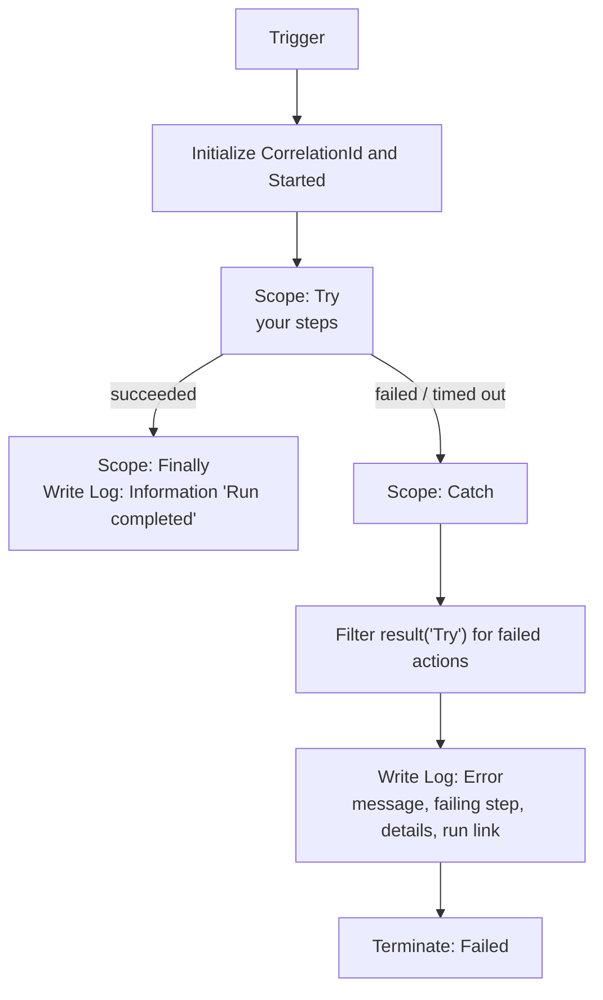

# Power Automate

Flows log by calling the **PPLF - Write Log** child flow. It routes to Dataverse, SharePoint or both, so your flow never changes when the target does.

## Requirements

- Your flow must be in a **solution** (child flows can only be called from solution flows).
- **PPLF - Write Log** must be on, with its connection references set.

## Log one entry

Add **Run a Child Flow** → **PPLF - Write Log**:

| Input | Example | Required |
|---|---|---|
| Level | `Error` | yes |
| Message | `@{body('Get_invoice')?['error']?['message']}` | yes |
| SourceName | `@{workflow()?['tags']?['flowDisplayName']}` | yes |
| Component | `Get invoice` | |
| Operation | `SyncInvoices` | |
| Details | `@{string(body('Get_invoice'))}` | |
| CorrelationId | from the trigger, if an app passed one | |
| RunUrl | see below | |
| ErrorCode | `@{outputs('Get_invoice')?['statusCode']}` | |
| DurationMs | `@{div(sub(ticks(utcNow()), ticks(variables('Started'))), 10000)}` | |

Link to the run that wrote the entry:

```text
@{concat('https://make.powerautomate.com/environments/', workflow()?['tags']?['environmentName'], '/flows/', workflow()?['name'], '/runs/', workflow()?['run']?['name'])}
```

## Start from the Try/Catch template

**PPLF - Template Try Catch** is a ready-made skeleton. Use **Save as** to copy it, then put your steps in **Try**.



The Catch scope collects every failed action inside Try with `result('Try')`, logs the first error message and the full list as details, then ends the run as **Failed**, so the run history stays honest and the log has the context.

## Standard-licence flows

**PPLF - Write Log** goes through the router, which can call the Dataverse writer. If a flow must use standard connectors only and your target is SharePoint, call **PPLF - Writer SharePoint** directly with a one-item `LogsJson` array:

```json
[{"level":"Warning","message":"Retrying","sourceName":"Nightly Sync","sourceType":"Cloud Flow"}]
```

See [licensing](licensing.md).

## Many entries at once

To write a batch, call **PPLF - Log Router** with `LogsJson` set to a JSON array of entries in the [wire format](https://github.com/OWNER/power-platform-logging-framework/blob/main/schema/log-entry.schema.json). The writers process up to 20 entries in parallel.

## The PPLF flows

| Flow | Trigger | Purpose |
|---|---|---|
| PPLF - Write Log | Child flow | Plain inputs for flow makers |
| PPLF - Log Router | Child flow | Reads `pplf_LogTarget`, calls the writers, sends alerts |
| PPLF - Writer Dataverse | Child flow | Applies configuration, writes rows |
| PPLF - Writer SharePoint | Child flow | Applies configuration, writes items (standard connectors) |
| PPLF - Ingest from Power Apps | Power Apps (V2) | Canvas Router mode |
| PPLF - Ingest from Power Pages | Power Pages | Power Pages logger |
| PPLF - Provision SharePoint | Power Apps (V2) | Creates the lists from the setup wizard |
| PPLF - Retention Cleanup | Daily | Deletes old entries |
| PPLF - Forward Dataverse Logs to SharePoint | Dataverse row added | Moves pro-code entries to SharePoint when the target is SharePoint |
| PPLF - Template Try Catch | Manual | Starting point for new flows |
